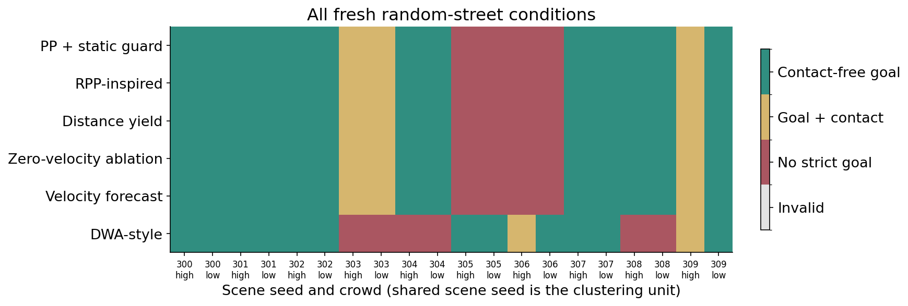

# 新一轮经典基线对照与小型预测模块研究

本轮已完成本地原生三维实验。没有下载、训练模型或启动星流，**没有清理或删除文件**。旧版 proposal 原件和逐字节副本全部保留，新增 v3。GenAI 声明与截图继续按你的要求留待后续。

## 先看这些文件

- [v3 Proposal PDF](../report/Week3_Streetscape_Research_Proposal_v3.pdf) / [可编辑 Word](../report/Week3_Streetscape_Research_Proposal_v3.docx)：五页，含两幅实际结果/街景图和六篇参考文献。
- [真实三维横穿对比](../outputs/classical/videos/classical_crossing_comparison.mp4)：RPP-inspired、预测模块、DWA-style，同一开发场景、同一行人运动；不是总体成绩的替代。
- [到达—停车—保存街景](../outputs/classical/videos/inspection_mission.mp4) / [实际保存图片](../outputs/classical/videos/inspection_view.png)。
- [固定障碍边界案例](../outputs/classical/videos/stationary_limitation.mp4)：保留无法绕开的失败。
- [论文与方法的通俗解释](classical_literature_and_design_20261102.md) / [完整复现流程](classical_reproduction_20261102.txt)。

## 这次修正了比较方式

此前 PPO 到达率偏低，涉及路线信息、动作接口、训练任务与转移条件，不能代表成熟经典控制。新一轮取消神经策略推理，六种方法共用完整路线、当前状态/行人速度、原生平面碰撞盒、有限制动和静态物体保护。RPP-inspired 与 DWA-style 是适配版本，没有声称完整复现原论文或 Nav2。
预测模块只做一个小问题：沿现有路线预测不同速度的后果。零速度消融保留同样的候选/几何/代码，只把行人速度置零，直接检验速度信息的作用。DWA-style 额外搜索转角，帮助了解速度选择的边界。

## 冻结后的随机街景结果

开发48次，测试120次（6方法 × 5/15人 × 10个新seed300–309）。每方法请求20个匹配条件，有效20个，无效0个；无效任务按预先规则保留，不补抽。严格到达要求原生标记且距终点≤2m。

| 方法 | 严格到达 | 行人接触 | 无任何接触到达 | 平均等待 s | 平均盒距离<1m时间比例 |
|---|---:|---:|---:|---:|---:|
| PP + 公共静态保护 | 16/20 | 3/20 | 13/20 | 9.47 | 0.46% |
| RPP-inspired | 16/20 | 3/20 | 13/20 | 10.38 | 1.41% |
| 当前距离让行 | 16/20 | 3/20 | 13/20 | 9.90 | 1.27% |
| 零速度预测消融 | 16/20 | 3/20 | 13/20 | 10.31 | 1.43% |
| 路线 + 速度预测 | 16/20 | 3/20 | 13/20 | 10.52 | 1.40% |
| DWA-style | 14/20 | 2/20 | 12/20 | 14.55 | 0.84% |

接触数按 episode 计；无任何接触到达还排除静态物体、建筑、人行道等接触。近距离比例使用原生平面盒间距，和 v2 的圆形代理不是同一指标；它也不等于舒适感。

### 预测的实际增量

- 相对RPP-inspired：挽回0个到达、退化0个；无接触到达净变化+0个；在16个共同成功条件上耗时差-3.16s。
- 相对当前距离让行：挽回0个到达、退化0个；无接触到达净变化+0个；在16个共同成功条件上耗时差-0.09s。
- 相对零速度预测消融：挽回0个到达、退化0个；无接触到达净变化+0个；在16个共同成功条件上耗时差+0.28s。
- 相对DWA-style：挽回6个到达、退化4个；无接触到达净变化+1个；在10个共同成功条件上耗时差+0.34s。

速度预测与零速度消融的行人接触分别为3和3；无接触到达分别为13和13。这是对新增速度信息最直接的对照，不能把全部路线跟踪收益算给预测。

本轮预测模块与 RPP-inspired 的无接触到达数量相同，未得到这一主要指标的提升。研究价值在于明确比较了增量与失败边界；不应为了作业把结果写成全面胜出。
作为更简单的对照，PP+公共静态保护也得到16次到达、13次无接触到达，平均等待9.47s、近距离暴露0.46%；预测版本分别为10.52s和1.40%。本轮没有证明新增预测复杂度适合作为默认方案。
按10个场景seed整组重采样、保留两个人数条件，预测减RPP的无接触到达差为+0.0个百分点，描述性95%区间[0.0, 0.0]个百分点。这些配对结果逐项相同，因此自助区间退化为零；它不证明总体差异为零，也不是等效性检验。小样本不支持罕见风险承诺。

## 单行人诊断：单独报告

开发20次，另用seed320–321完成40次新测试。横穿、远离、迎面和静止分别为2个条件。行人按规定轨迹放置，机器人完全使用原生物理；控制器不读取未来脚本。这是用于解释机制的受控实验，不能与随机5/15人街景合并。

| 相遇类型 | RPP无接触到达/2 | 距离/2 | 零速度/2 | 预测/2 | DWA/2 |
|---|---:|---:|---:|---:|---:|
| 横穿 | 2 | 2 | 2 | 2 | 1 |
| 远离 | 2 | 2 | 2 | 2 | 2 |
| 迎面接近 | 0 | 0 | 0 | 0 | 1 |
| 固定障碍 | 0 | 0 | 0 | 0 | 0 |

- 横穿时，预测平均等待0s，RPP-inspired约1s；但预测的<1m暴露为2.42%，RPP为0%。这是效率与近距离暴露的权衡。
- 远离时，所有方法均无接触完成；不能声称本轮已经证明预测在远离场景优于所有基线。
- 迎面时，四个只调速的版本都在两个条件发生接触；DWA-style得到一次无接触到达，另一次未到达。这说明横向选择可能重要，仍不构成统一优势。
- 静止时，所有方法均未完成。沿既定路线快慢选择不能替代真正绕行/重规划。

## 验证、保留和局限

47项测试通过；开发数据29,466步、受控新测试19,050步及随机新测试的全部决策已独立重放/重算。冻结源文件22份；同一条件初始路线、状态和几何一致。真实RGB重复与无画面运行位置/动作/行人差异均为0。停车演示末一秒最高实测速率约0.065m/s。
使用理想状态和完整路线；预测忽略未来转向速率限制和详细轮胎瞬态，碰撞盒也只是采样平面近似。静态保护不覆盖完整道路/路沿网格。短时几何可行不等于真实安全，行人脚本或预规划也不是自然人的互惠反应。每个人数条件共享场景seed，不能当作20个独立城市布局。

## 作业对应与下一步

五个沿给定路线跟踪的版本共同在seed305/306、5/15人时超时，共4个条件。末步移动候选均未通过静态足迹buffer，停车候选通过；这表明检查造成长期停顿，并不证明物理路线无法通行。DWA-style却完成了这4个条件，其中3个无接触，但又在预测版本能完成的另6个条件失败。因此，有条件地增加横向选择，比把全程控制都换成DWA更值得进一步检验。

v3按Option1组织：具体城市研究问题、公共空间与社会导航评估视角、数据/变量/空间单位、公平方法/消融、预实验结果、120次可行后续计划及不确定性/伦理讨论。预实验可以保留负结果，并不要求SOTA。主文五页、六篇文献；GenAI附录仍待你后续完成。
后续proposal聚焦一个尚未实现的小绕行触发器：静态足迹检查导致停车超过3秒时，尝试左右不超过1.5m的局部航点，仍须通过足迹buffer与可行走区域检查，否则继续等待。用10个新seed × 2布局家族 × 2人数 × 3方法（RPP、预测、预测+绕行）共120次检验。先开发与冻结，再跑新seed；不把未实施模块写成已有成绩。

- [正式逐episode CSV](../outputs/classical/test/episodes.csv) / [汇总](../outputs/classical/test/summary.csv) / [匹配差异](../outputs/classical/test/paired.csv)。
- [全部失败/接触索引](../outputs/classical/failure_index.json)。
- [版本索引与旧版入口](../report/VERSIONS.md)。
- [中央执行、验收和发布记录](../../../../storage_management/ucmp_week3_classical_baselines_20261102-104447/README.md)。

本轮不执行清理。日志去重仅改变新运行的写入方式，旧日志、旧proposal和旧发布包全部保持原样。
